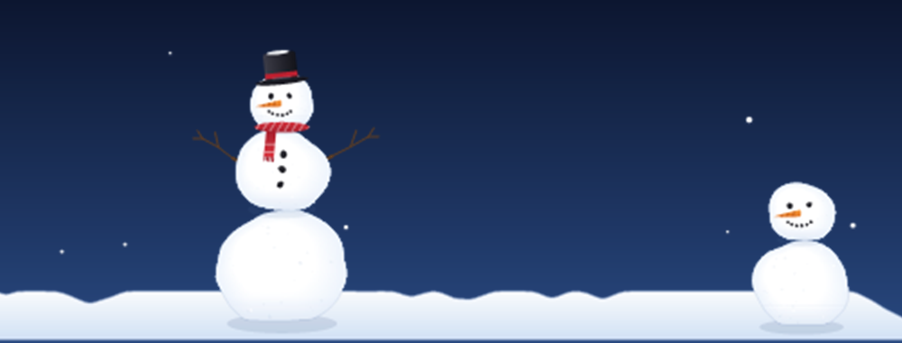
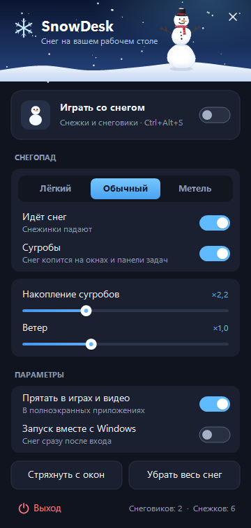

# ❄️ SnowDesk

**Настоящий снег на рабочем столе Windows.** Снежинки падают поверх экрана, копятся сугробами на окнах и панели задач, а из снега можно слепить снеговика.



## Возможности

- **Сугробы на окнах.** Снег ложится на верхние края окон и на панель задач. Края сугробов скруглены по углам окон Windows 11.
- **Живая физика.** Если сдвинуть окно, изменить его размер, свернуть или закрыть, снег с него осыпается вниз.
- **Игра со снегом** (Ctrl+Alt+S):
  - зажмите ЛКМ на сугробе, и получится снежок; катайте его по снегу, и он растёт;
  - положите шар на шар, и получится снеговик. Из двух шаров выйдет голова с лицом, из трёх добавятся шляпа, шарф, руки-веточки и пуговицы;
  - резко дёрните мышью, и снежок полетит. Если бросить его за край экрана, он вылетит с другой стороны;
  - ПКМ по сугробу подбрасывает снег, ПКМ по снежку разбивает его.
- **Не мешает работе.** Клики проходят сквозь снег. Программа прячется в играх и полноэкранном видео.
- **Панель управления** по клику на снежинку в трее: сила снегопада, сугробы, ветер, скорость накопления, автозапуск.
- **Лёгкая.** Около 60 кадров в секунду, несколько миллисекунд на кадр. Один `.exe`, установка не нужна.



## Установка

1. Скачайте `SnowDesk.exe` со страницы [Releases](../../releases).
2. Запустите его. В трее появится снежинка.

> Программа не подписана цифровой подписью, поэтому при первом запуске Windows может показать окно
> «Windows защитила ваш компьютер». Нажмите **«Подробнее» → «Выполнить в любом случае»**.
> Весь исходный код открыт: можно проверить его или собрать программу самостоятельно.

## Сборка из исходников

Нужен только встроенный в Windows .NET Framework 4.x, Visual Studio не требуется.

```bat
build.bat
```

Файлы:
- `SnowDesk.cs` — снег, сугробы, физика, режим игры;
- `SnowPainter.cs` — отрисовка снежков и снеговиков;
- `ControlPanel.cs` — панель управления.

Настройки хранятся в `%APPDATA%\SnowDesk\settings.txt`.

## Требования

Windows 10 или 11. Скруглённые углы сугробов работают в Windows 11.

---

### English

**SnowDesk** — falling snow for your Windows desktop. Snow piles up on top of windows and the taskbar and falls off when you move, resize or close a window. Press **Ctrl+Alt+S** to play: scoop snow into snowballs, roll them to make them bigger, stack them into snowmen and throw them across the screen. Click the tray icon to open the settings panel. It is a single `.exe` with no installer, and you can build it with `build.bat` (.NET Framework 4.x).

## Лицензия

[MIT](LICENSE)
